# Emergency Healthcare Access in Saskatchewan (ArcGIS Pro + Python)

How long does it take Saskatchewan residents to drive to the nearest hospital emergency department? This project builds a province-wide road network in ArcGIS Pro Network Analyst. It measures drive time from every 2021 census dissemination area to the nearest hospital, tests whether access differs for seniors, Indigenous residents and lower-income areas, maps where poor access clusters, and uses location-allocation to find where new emergency sites would help the most people.

The whole workflow is scripted with **arcpy** and runs from raw open data to finished map layouts in one command.

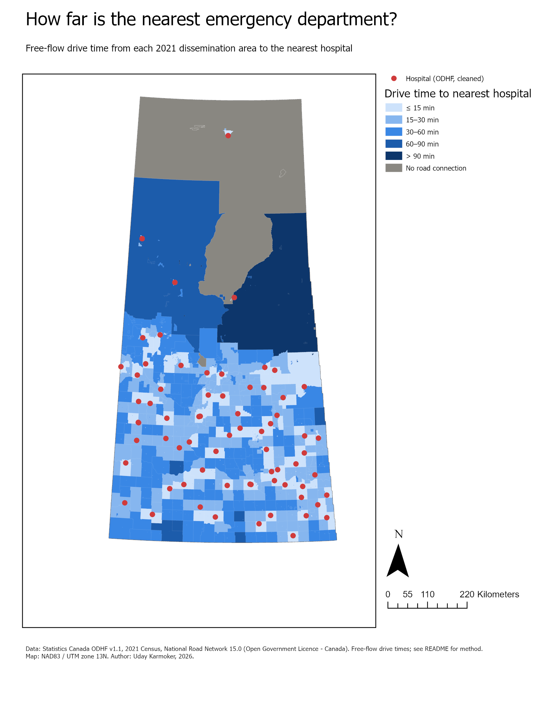

## Research questions
1. What share of Saskatchewan's 1.13 million residents live within 15, 30, 60 and 90 minutes of a hospital?
2. Are seniors (65+), Indigenous residents or lower-income areas more likely to face long drives?
3. Where do areas with long drive times cluster significantly?
4. If the province added 1–3 emergency sites, where would they bring the most people within 30 minutes?
5. In the eight largest cities, how evenly do EDs share the population, and how much worse would access get if one ED closed?

## Key findings
| Drive time to nearest hospital | All residents | Age 65+ | Indigenous identity |
|---|---|---|---|
| ≤ 15 min | 73.8% | 72.1% | 62.4% |
| 15–30 min | 14.8% | 15.8% | 14.6% |
| 30–60 min | 9.3% | 10.9% | 12.9% |
| 60–90 min | 0.8% | 0.5% | 3.8% |
| > 90 min | 1.0% | 0.6% | 4.9% |
| No road connection | 0.3% | 0.1% | 1.3% |

- **88.6% of residents (1.00 million people) live within 30 minutes of a hospital.** About 129,000 people are farther than that.
- **Indigenous residents face the largest gap.** Their population-weighted average drive is 24.0 minutes, against 13.3 minutes for the province overall. They are about 5 times more likely than the average resident to be more than 90 minutes away or have no road connection. Seniors are close to the provincial average.
- **Access follows income.** In the lowest-income fifth of dissemination areas, 14.8% of residents are more than 30 minutes from a hospital. In the highest-income fifth, 0.9% are.
- **Long drive times cluster in the north.** Getis-Ord Gi* (with false discovery rate correction) finds 83 dissemination areas in significant hot spots at 99% confidence, almost all in the Northern Saskatchewan Administration District.
- **New sites would bring modest gains.** Maximize Coverage location-allocation picks Earl Grey, Glen Ewen and Bethune. Together they bring about 14,700 more people within 30 minutes (88.6% → 89.9%). The large northern gaps cannot be closed within a 30-minute standard, because communities there are small and far apart. Those areas need other models, such as air ambulance, nurse-led clinics or a longer service standard.

| Access by population group | Access by household income |
|---|---|
| 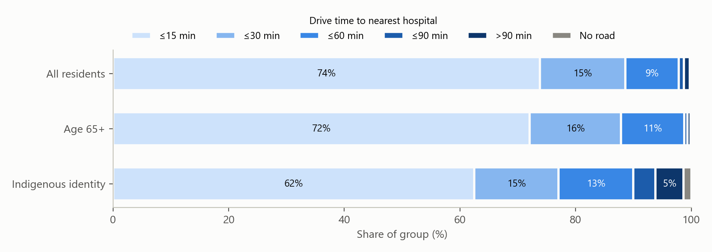 | 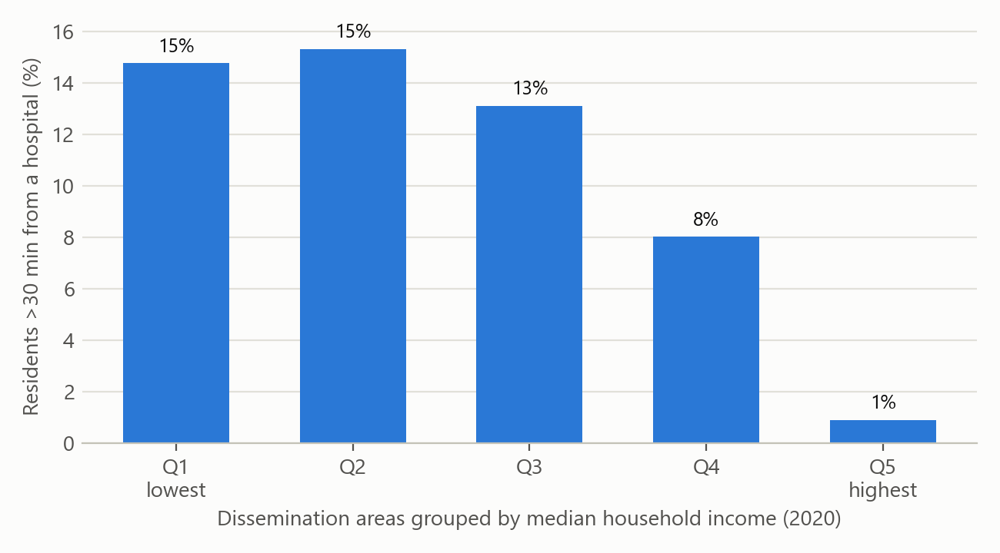 |

| Drive-time service areas | Hot spots and proposed sites |
|---|---|
| 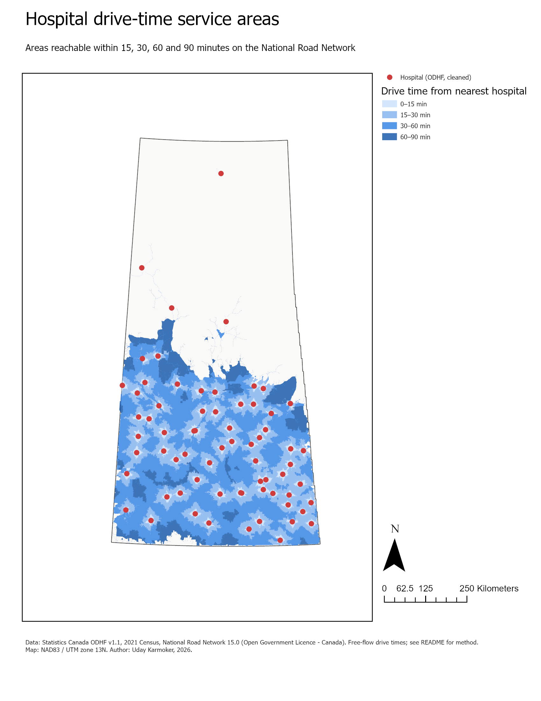 | 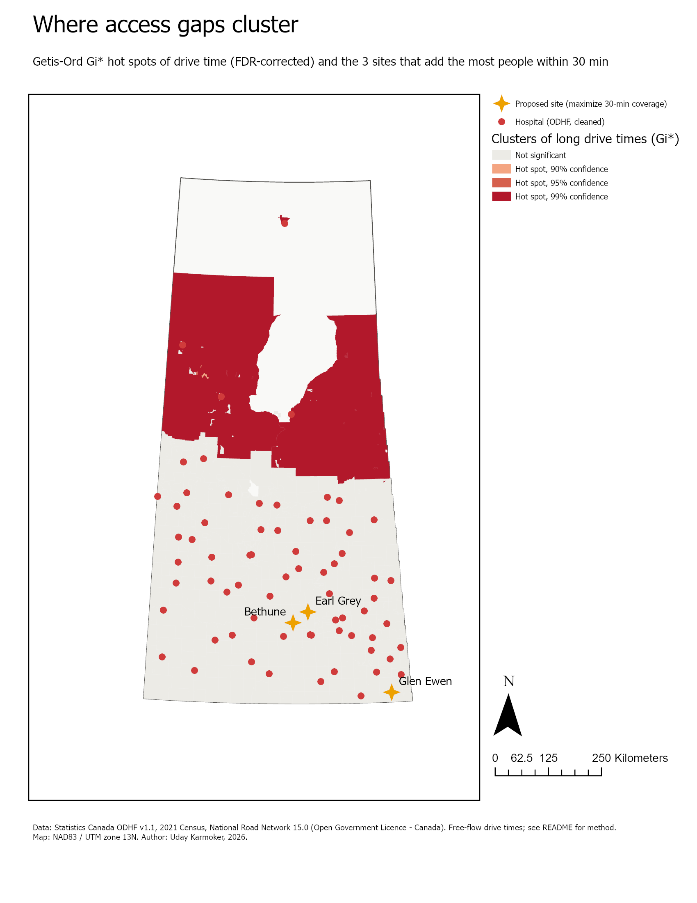 |

## City-level results: the eight largest cities
Inside cities nearly everyone is within 15 minutes, so the city analysis uses 5/10/15-minute bands. It asks two questions: how evenly emergency departments share the load, and what happens if one of them closes. That second question matters because Saskatchewan EDs regularly cut hours or close on short notice; Saskatoon City Hospital's ED, for example, runs reduced hours and closes when no physician is available.

| City | Residents | EDs | Mean drive (min) | Within 5 min | Closure scenario: worst case |
|---|---|---|---|---|---|
| Saskatoon | 266,141 | 3 | 5.4 | 41% | St. Paul's: +2.8 min for 76,583 residents |
| Regina | 226,404 | 2 | 5.1 | 42% | Pasqua: +3.1 min for 118,920 residents |
| Prince Albert | 37,756 | 1 | 5.1 | 51% | Victoria: +26.7 min for 37,756 residents |
| Moose Jaw | 33,665 | 1 | 5.3 | 56% | Dr. F.H. Wigmore: +41.3 min for 33,665 residents |
| Swift Current | 16,750 | 1 | 3.9 | 79% | Cypress Regional: +25.6 min |
| Yorkton | 16,280 | 1 | 3.4 | 75% | Yorkton Regional: +23.9 min |
| North Battleford | 13,836 | 1 | 2.6 | 100% | Battlefords Union: +34.1 min |
| Lloydminster (SK part) | 11,843 | 1 | 3.4 | 97% | Lloydminster Hospital: +32.0 min |

- **Single-ED cities have no backup.** If the one ED in Moose Jaw, Prince Albert, Swift Current, Yorkton, North Battleford or Lloydminster closes, the whole city's nearest emergency care moves 24–41 minutes away. In Moose Jaw's case it moves to Regina's Pasqua Hospital.
- **Saskatoon and Regina have redundancy in distance but not in capacity.** Closing any one ED adds only 1–3 minutes. But closing Royal University Hospital sends 95% of its 150,000 residents to City Hospital, the ED with reduced hours. The real constraint in the two large cities is capacity, not drive time.
- **The load is uneven in Saskatoon.** Royal University Hospital is the nearest ED for 56% of residents, St. Paul's for 29% and City Hospital for 15%. In Regina it is close to an even split: Pasqua 52%, General 48%.
- **The income pattern reverses inside cities.** In Saskatoon, Regina and North Battleford, higher-income areas are *farther* from an ED (Spearman ρ ≈ 0.6, p < 0.001), because newer, wealthier suburbs sit on the city edge and the hospitals are central. Across the province, lower-income areas are the ones with longer drives. Distance is not the main barrier for lower-income city residents, so other factors such as car ownership and transit access are worth studying next.

| Access bands by city | Closure scenarios |
|---|---|
| 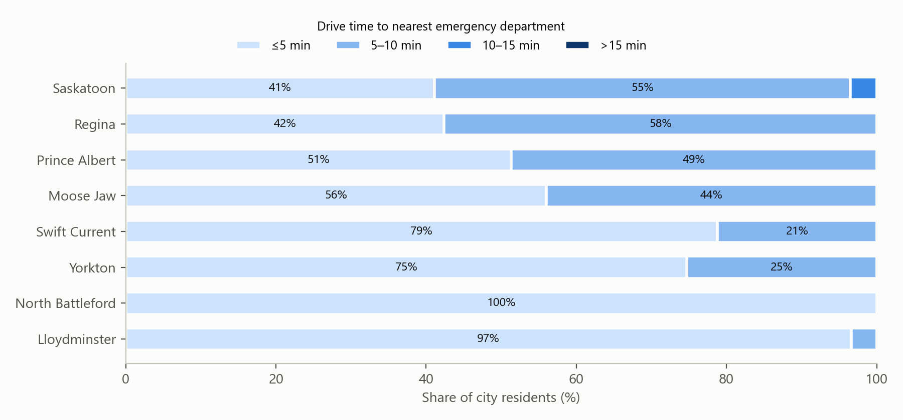 | 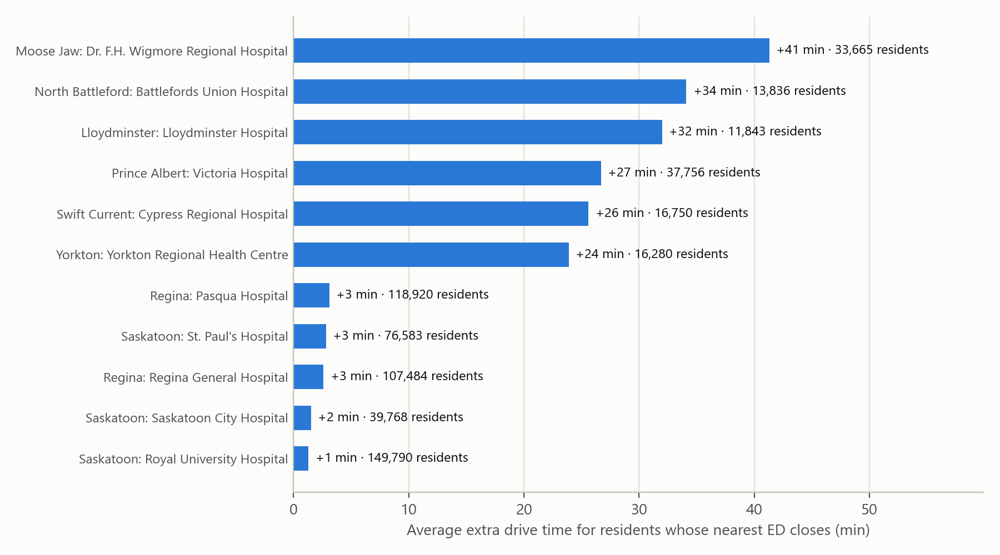 |

### City by city
Each map shows drive time from every dissemination area to its nearest emergency department (ED) in 5-minute bands, with ED catchment boundaries (black), city limits (red) and EDs (red dots). PDF versions are in [`maps/cities/`](maps/cities/).

#### Saskatoon: 266,141 residents, 3 EDs
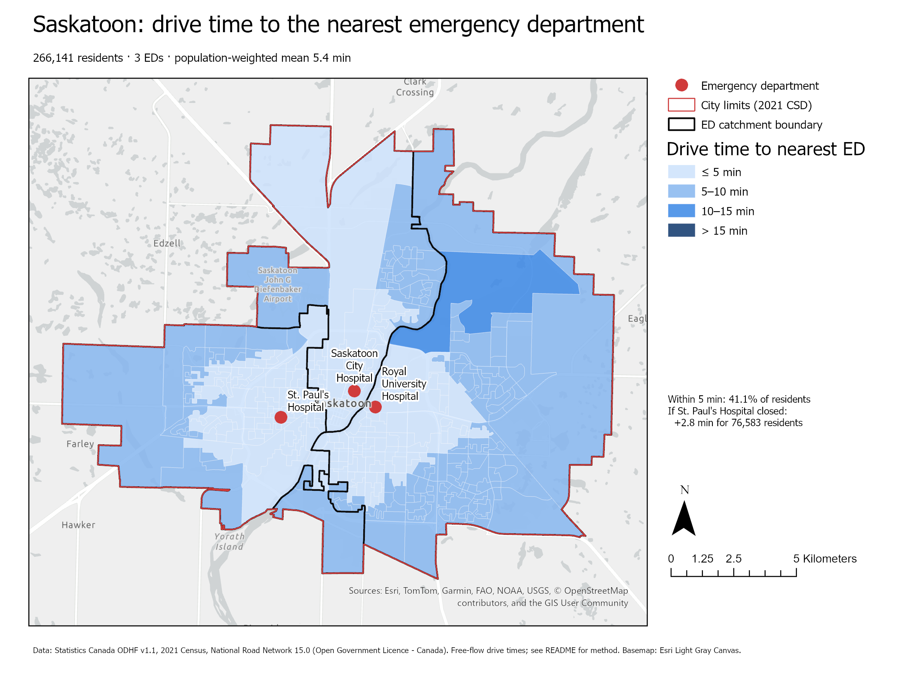

- **Access:** 41% of residents are within 5 minutes of an ED and nearly all of the rest within 10. The longest drive is 10.8 minutes, in the new north-east suburbs across the river.
- **Load:** Royal University Hospital is the nearest ED for 56% of the city (149,790 people), St. Paul's for 29% (76,583) and City Hospital for 15% (39,768). St. Paul's catchment holds the most Indigenous residents (13,745), on the west side.
- **Closures:** Closing any one ED adds only 1–3 minutes on average. But City Hospital is the fallback for 95% of Royal University's catchment and 100% of St. Paul's, and it is the ED with reduced hours. If Royal University closed, 22,851 people would be more than 10 minutes from an ED, up from 9,273.
- **Income:** Higher-income areas are farther from an ED (ρ = 0.60), because the newer suburbs on the city edge are wealthier.

#### Regina: 226,404 residents, 2 EDs
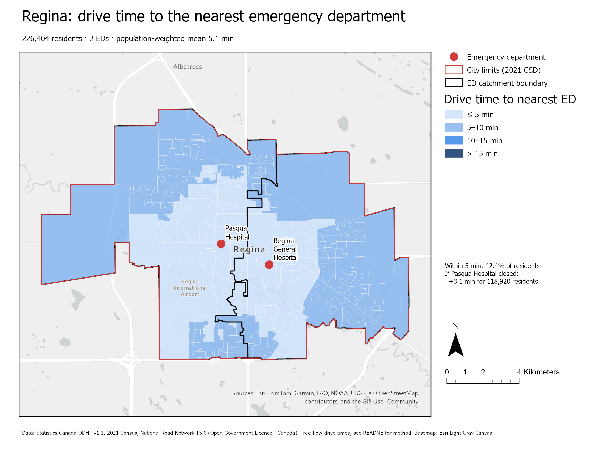

- **Access:** 42% of residents are within 5 minutes and everyone is within 10; the longest drive is 9.4 minutes.
- **Load:** The two EDs split the city almost evenly: Pasqua serves the west (52%, 118,920 people) and Regina General the east (48%, 107,484).
- **Closures:** Each hospital is the other's only backup. Closing Pasqua adds 3.1 minutes for its 118,920 residents and leaves 24,354 people more than 10 minutes away, up from none today. Closing Regina General adds 2.6 minutes and leaves 25,879 people beyond 10 minutes.
- **Income:** Same suburban pattern as Saskatoon (ρ = 0.61). The outer suburbs have the longest drives.

#### Prince Albert: 37,756 residents, 1 ED
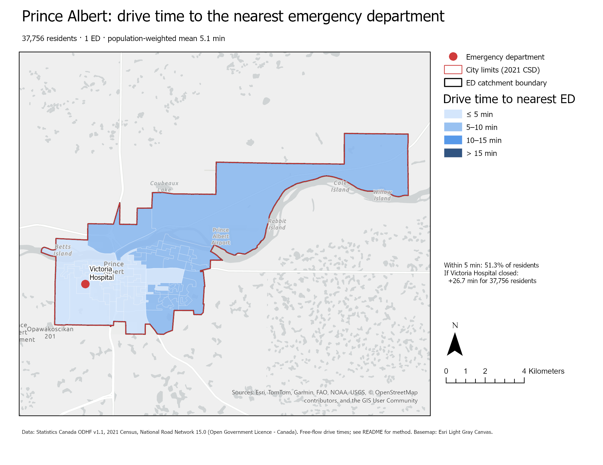

- **Access:** Victoria Hospital is within 5 minutes for 51% of residents and within 10 minutes for everyone.
- **Population:** It has the largest Indigenous population of the eight cities, 16,145 people (43% of residents). Victoria Hospital is also the referral centre for much of northern Saskatchewan.
- **Closure:** If Victoria's ED closed, the nearest alternative is Shellbrook, a small rural hospital. That adds 26.7 minutes for the whole city.

#### Moose Jaw: 33,665 residents, 1 ED
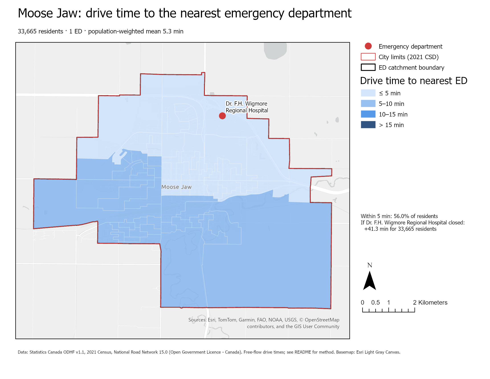

- **Access:** Dr. F.H. Wigmore Regional Hospital sits on the north edge of the city. 56% of residents are within 5 minutes; the south and west sides of the city are 5–10 minutes away.
- **Closure:** This is the most exposed city. Closing Wigmore's ED sends all 33,665 residents to Regina's Pasqua Hospital, **41.3 minutes** farther away on average.

#### Swift Current: 16,750 residents, 1 ED
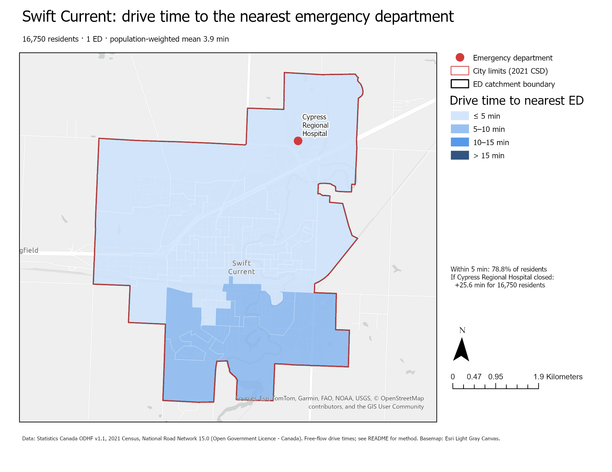

- **Access:** Compact and well served: 79% of residents are within 5 minutes of Cypress Regional Hospital, and the longest drive is 7.4 minutes.
- **Closure:** The next nearest ED is the small facility in Herbert, adding 25.6 minutes.

#### Yorkton: 16,280 residents, 1 ED
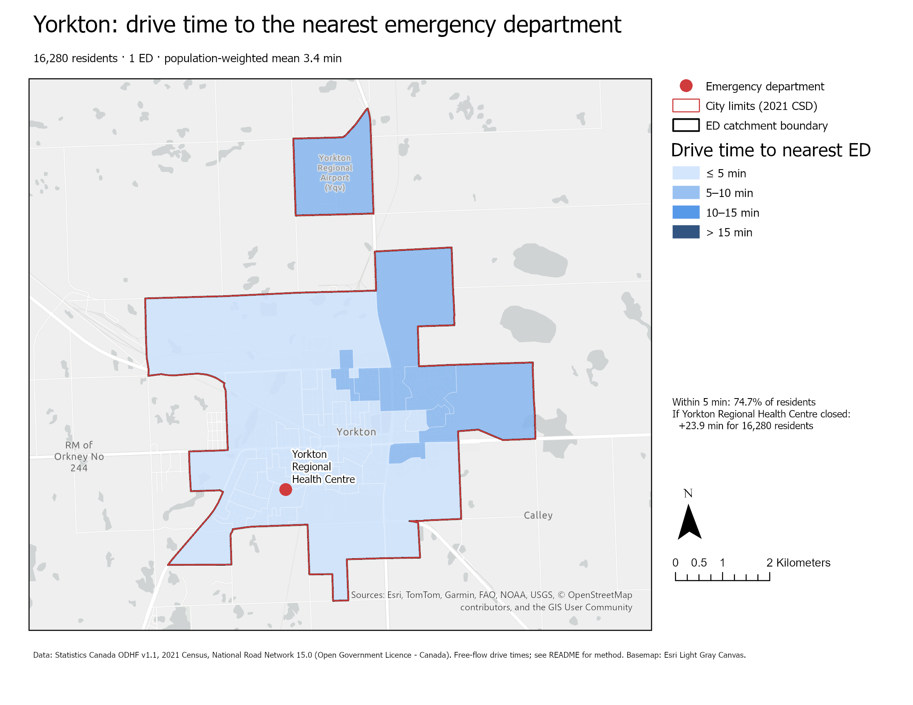

- **Access:** 75% of residents are within 5 minutes of Yorkton Regional Health Centre, and everyone is within 8.3 minutes.
- **Closure:** Residents would split between Melville's St. Peter's Hospital (84%) and Canora (16%), adding 23.9 minutes on average.

#### North Battleford: 13,836 residents, 1 ED
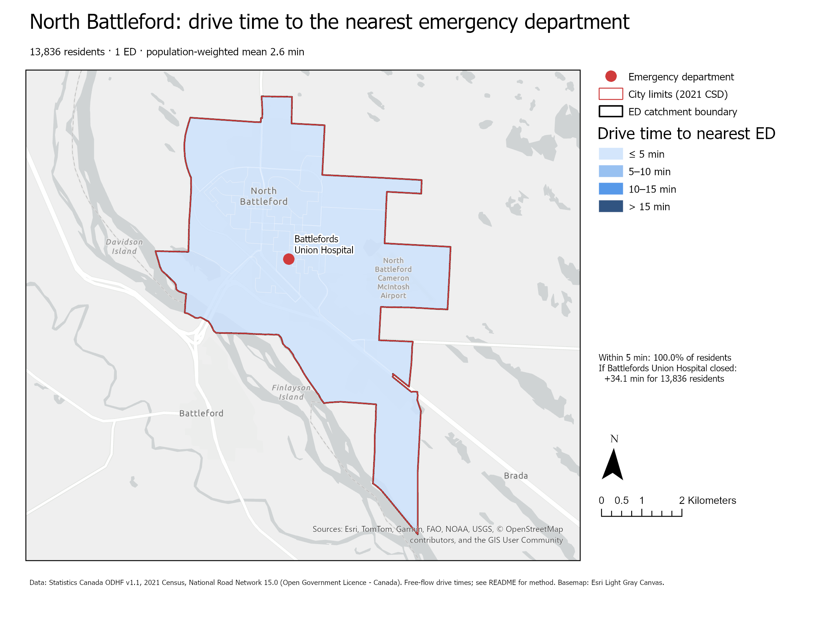

- **Access:** The best-served city: every resident is within 5 minutes of Battlefords Union Hospital (mean 2.6 minutes). It also has the second-largest Indigenous share of the eight cities (26%).
- **Closure:** The nearest alternative is Wilkie, a small district hospital, which adds 34.1 minutes. In practice patients would more likely go to Saskatoon, which is farther again.

#### Lloydminster (Saskatchewan side): 11,843 residents, 1 ED
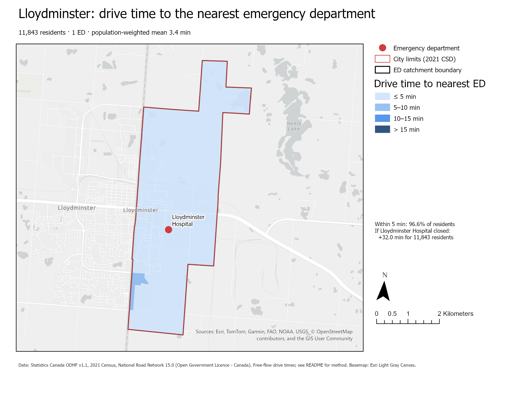

- **Access:** 97% of Saskatchewan-side residents are within 5 minutes of Lloydminster Hospital.
- **Closure:** The nearest Saskatchewan alternative is Maidstone, adding 32.0 minutes. This overstates the real impact, because Alberta hospitals such as Vermilion are not in the model. This is the clearest example of the province-boundary limitation.

**City method** (`08_city_analysis.py`, `09_city_maps.py`)
- City limits are the 2021 census subdivision boundaries from Statistics Canada.
- Each dissemination area is assigned to a city by where its demand point falls.
- Each ED's catchment is the set of areas for which it is the nearest ED, dissolved into one polygon.
- Closure scenarios re-solve the OD Cost Matrix for each city with one ED removed. Each reports the residents displaced, their average extra minutes and where they would go instead.
- The maps use one ArcGIS Pro layout that the script moves from city to city, working like a map series.

**City caveats**
- A closure sends people to the *nearest* remaining hospital, which may be a small rural facility (for example Wilkie for North Battleford) rather than a regional centre that can take them.
- Urgent care centres in Saskatoon and Regina are not modelled.

## Data (all open, Open Government Licence – Canada)
| Layer | Source | Notes |
|---|---|---|
| Hospitals | Statistics Canada, Open Database of Healthcare Facilities (ODHF) v1.1 | 96 records → 70 sites after cleaning |
| Roads | National Road Network (NRN) 15.0, Saskatchewan | 299,096 segments, with speed limit, road class and surface |
| Census areas | 2021 dissemination area boundaries (StatCan ArcGIS REST service) | 2,625 dissemination areas |
| Population | 2021 Census Profile (StatCan SDMX API) | Total, age 65+, Indigenous identity, median household income |

## Method
1. **Clean the hospital list** (`02_prepare_data.py`)
   - Kept ODHF records classed as Hospitals.
   - Removed psychiatric and rehabilitation facilities, and Moose Jaw Union Hospital (replaced by Dr. F.H. Wigmore Regional in 2015).
   - Filled missing coordinates from another record in the same town, or from National Road Network place names.
   - Merged records within 400 m of each other as duplicates.
2. **Calculate drive time on each road segment.** Minutes = length ÷ speed. Speed is the posted NRN limit where present, otherwise a default for the road class. Gravel and dirt roads are slowed by 20%. Winter roads are excluded.
3. **Place demand points where people live.** A large rural dissemination area's centre can fall in empty bush. Each area's point is placed at its densest cluster of local streets instead: the street midpoint with the most other street midpoints within 1.5 km. 2,214 areas use this method; 411 with no local streets keep a geometric interior point.
4. **Build the network dataset** (`03_build_network.py`). arcpy can only create a network with a Length cost. The script exports the network schema to an XML template, adds a `Minutes` cost attribute and a "Driving Time" travel mode, then recreates and builds the network from the edited template. Check: Regina General → Royal University Hospital is 258 km and 155 min.
5. **Find the nearest hospital for every area** (`04_access_analysis.py`). An OD Cost Matrix (`arcpy.nax`) gives each demand point its nearest hospital and drive time. Population is then summed by time band, and population-weighted averages are calculated. Service Area produces 15/30/60/90-minute rings.
6. **Spatial statistics and equity** (`05_hotspots_equity.py`). Hot Spot Analysis (Getis-Ord Gi*) runs on drive time using 8 nearest neighbours, because dissemination areas range from city blocks to thousands of km². False discovery rate correction is applied. Drive time is also summarised by household-income quintile.
7. **Location-allocation** (`06_location_allocation.py`). Maximize Coverage with a 30-minute cutoff. The 70 hospitals are required facilities. The 307 populated dissemination areas currently more than 30 minutes away are candidate sites, and every area is weighted by population. The model is solved for 1, 2 and 3 new sites. The optimal sites are not nested: Silton is best for one site, but Earl Grey and Bethune are best as a pair.
8. **Cartography** (`07_make_maps.py`). `arcpy.mp` builds `SK_Health_Access.aprx` from the blank project that ships with Pro. It creates three maps with symbology and three print layouts (legend, north arrow, scale bar, credits), and exports them to PDF and PNG.

## Reusable geoprocessing tool
`toolbox/HealthAccess.pyt` packages the analysis as an ArcGIS Pro tool called **Nearest Facility Drive-Time Access**. Given any network dataset, travel mode, facilities and population points, it writes drive time and access band to each point and reports the population in each band. It can be re-run for pharmacies, schools or EMS bases. On this project's data it reproduces the script results exactly.

## Limitations
- **Facility list.** ODHF v1.1 was compiled in 2020. Temporary emergency-department closures and staffing disruptions, which have been frequent in rural Saskatchewan, are not modelled, so access in practice is likely worse than shown.
- **Province boundary.** Hospitals in Alberta and Manitoba are excluded, so border communities (e.g. near Flin Flon or Lloydminster's Alberta side) may be overstated as underserved.
- **Northern health centres.** Northern nursing stations and health centres classed as ambulatory care in ODHF are not counted as emergency departments, even though some provide emergency care.
- **Drive times.** These are free-flow: no traffic, weather or seasonal road closures. Ferries and winter roads are excluded.
- **Demand points.** Each dissemination area is represented by one point, which hides variation inside large rural and northern areas.
- **Hot-spot map.** Large northern polygons dominate visually. The finding should be read together with the population tables, not from the area shaded.

## How to run
Requires ArcGIS Pro 3.x with the Network Analyst extension (developed on Pro 3.4, Advanced licence). Close the project in ArcGIS Pro first.

```bash
"C:\Program Files\ArcGIS\Pro\bin\Python\envs\arcgispro-py3\python.exe" scripts/run_all.py
```

Raw data (~300 MB) is downloaded automatically. The full pipeline takes about 25 minutes. Then open `SK_Health_Access.aprx` in ArcGIS Pro.

## Repository layout
```
scripts/   01–09 pipeline steps (08–09 = city analysis), config.py, run_all.py
toolbox/   HealthAccess.pyt (reusable geoprocessing tool)
maps/      exported layouts (PNG, PDF); maps/cities/ has one map per city
figures/   charts
outputs/   cleaned hospital list, per-DA access table, summary tables
data/      raw downloads and file geodatabase (rebuilt by the pipeline, not committed)
```

## Skills demonstrated
ArcGIS Pro · arcpy · Network Analyst (network dataset creation, OD Cost Matrix, Service Area, Location-Allocation, closure scenarios) · Spatial Statistics (Getis-Ord Gi*) · `arcpy.mp` cartography automation · Python toolboxes · REST and SDMX APIs · pandas · matplotlib · data cleaning and QA · census and equity analysis

## Author and AI use
Uday Karmoker. The analysis design, code and documentation were developed with help from Claude (Anthropic) as an AI pair programmer. All results were run locally in ArcGIS Pro 3.4 and checked against known values: a provincial population total of 1,132,505, and the Regina–Saskatoon drive time.
